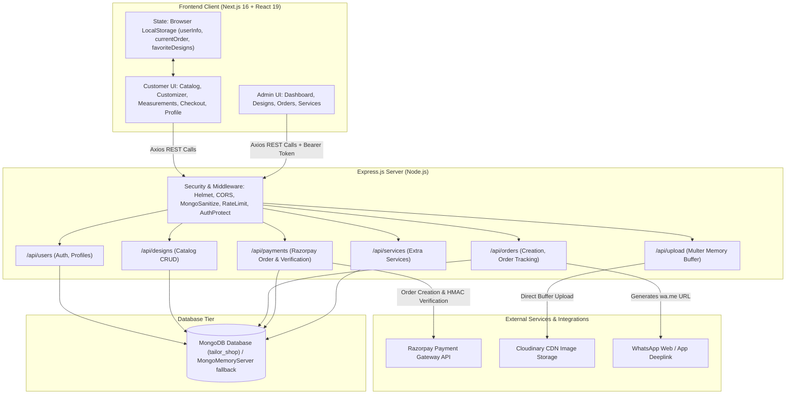
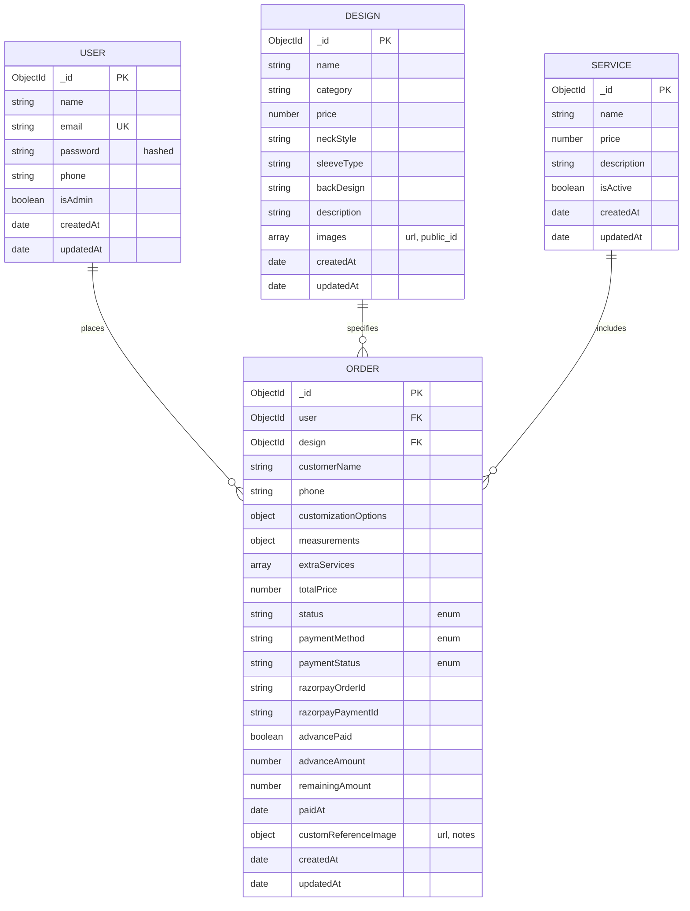
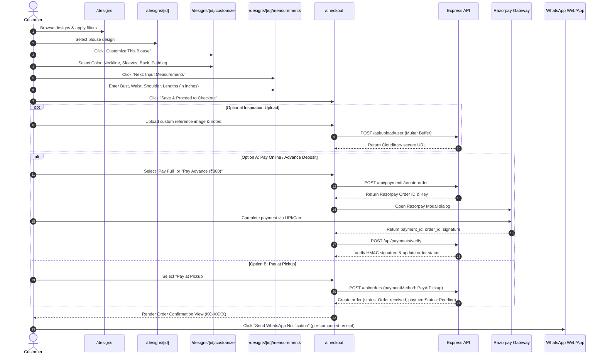

# Comprehensive Technical Project Report: Keerti Couture

---

## 1. PROJECT OVERVIEW

### 1.1 Project Name
**Keerti Couture** (Tailoring Shop & Designer Blouse Tailoring Platform)

### 1.2 Main Purpose
Keerti Couture is a full-stack, bespoke e-commerce and tailoring platform designed specifically for custom women's ethnic apparel, focusing on designer and bridal blouses. The application enables customers to browse a curated, Pinterest-inspired gallery of blouse designs, customize stylistic and structural features (necklines, sleeve lengths, back patterns, padding, colors, embroidery), submit precise anatomical body measurements in inches, upload custom reference/inspiration imagery, select flexible payment options (Full Online Payment, Advance Deposit, or Pay at Pickup), and track the real-time craftsmanship status through a multi-stage tailoring pipeline. Additionally, it provides boutique managers with an administrative back-office to oversee the catalog, manage order queues, inspect measurement specifications, update payment and stitching statuses, and track business revenue.

### 1.3 Problem It Solves
Traditional women's bespoke tailoring suffers from significant friction:
- **In-Person Dependency:** Customers must visit physical tailoring boutiques multiple times—first for initial consultation, second for measurement taking, third for trial fittings, and fourth for pickup.
- **Ambiguous Customization:** Communicating complex design requests (neck depths, sleeve cuts, embroidery styles) via hand sketches or verbal descriptions often leads to miscommunication and inaccurate tailoring.
- **Lost or Inconsistent Measurements:** Tailors typically record measurements on physical notebooks that are easily lost, damaged, or misread.
- **Opaque Pricing & Progress:** Customers have no visibility into the stitching progress and often encounter unexpected pricing markups when collecting garments.
- **Deposit Inefficiencies:** Tailors struggle to manage advance payments versus final balances upon delivery.

Keerti Couture digitizes this entire workflow: design selection, modular visual customization, digital measurement capture, transparent tiered payments via Razorpay, real-time stage tracking, and seamless WhatsApp communication.

### 1.4 Target Audience
1. **End Consumers (B2C):** Modern women, brides-to-be, festival shoppers, and diaspora customers seeking premium, custom-fitted ethnic blouses and saree finishing without having to make repetitive visits to physical boutiques.
2. **Boutique Owners & Master Tailors (B2B/Internal):** Atelier staff and master tailors who need an organized digital management portal to view incoming orders, inspect exact inch-level measurements and reference photos, update garment production stages, and manage revenue balances.

### 1.5 Main Technologies and Frameworks Used

| Layer | Technology | Version | Purpose |
| :--- | :--- | :--- | :--- |
| **Frontend Framework** | Next.js (App Router) | `16.1.6` | Server/Client rendering, file-based routing, SEO, and static/dynamic optimization |
| **UI Library** | React | `19.2.3` | Component-based interactive user interface |
| **Styling & Theme** | Tailwind CSS / PostCSS | `^4.0.0` | Utility-first CSS styling, custom color variables, and luxury aesthetics |
| **Animation Engine** | Framer Motion | `^12.35.1` | Page transitions, hover cards, step progress animations, micro-interactions |
| **Icons** | Lucide React | `^0.577.0` | Consistent iconography across customer and admin interfaces |
| **HTTP Client** | Axios | `^1.13.6` | Client-side API requests to Express backend |
| **Backend Runtime** | Node.js | v18+ / v20+ | Server-side JavaScript runtime environment |
| **Backend Framework** | Express.js | `^4.22.2` | RESTful API server, routing, middleware orchestration |
| **Database & ODM** | MongoDB & Mongoose | `^9.2.4` | Document-oriented NoSQL database and schema modeling |
| **In-Memory DB** | mongodb-memory-server | `^11.0.1` | Zero-config embedded local database fallback for development |
| **Authentication** | JSON Web Tokens (JWT) & bcryptjs | `9.0.3` / `3.0.3` | Stateless token authentication & salted password hashing |
| **File Storage** | Multer & Cloudinary SDK | `2.1.1` / `2.9.0` | Multipart memory buffering and cloud asset hosting |
| **Payment Gateway** | Razorpay Node SDK & Checkout.js | `^2.9.6` | Online payment processing, advance deposits, and cryptographic signature verification |
| **Security Suite** | Helmet, express-mongo-sanitize, rate-limit | Latest | HTTP security headers, NoSQL injection stripping, and brute-force mitigation |

---

## 2. FEATURES

### 2.1 Complete List of Existing Features

#### Customer-Facing Features
1. **Responsive Editorial Homepage (`/`):**
   - Hero banner with brand mission, high-resolution imagery, and call-to-action triggers.
   - "Shop by Category" showcase grid linking directly to filtered gallery views.
   - "How It Works" 4-step workflow explainer (Choose Design $\rightarrow$ Enter Measurements $\rightarrow$ Expert Stitching $\rightarrow$ Home Delivery).
   - Core auxiliary services showcase (Saree Piko, Fall Stitching, Alterations, Urgent Stitching).
   - "The Keerti Couture Standard" quality guarantee cards (7-day alteration guarantee).
   - Client testimonial carousels and luxury footer with boutique coordinates and contact info.
   - Persistent, floating WhatsApp quick-contact launcher with interactive hover tooltip.
2. **Pinterest-Style Dynamic Design Gallery (`/designs`):**
   - Asymmetric CSS column masonry grid replicating the Pinterest visual browsing experience.
   - Client-side multi-filter drawer supporting concurrent filters: Category, Neck Style, Sleeve Length, and Back Pattern.
   - Instant text search across design titles and category strings.
   - Hover cards revealing category badges, neck styles, pricing, and fast-action customization links.
3. **Category Explorer (`/categories`):**
   - Curated visual cards for individual blouse silhouettes (Bridal, Designer, Boat Neck, Princess Cut, Back Open, Sleeveless, Puff Sleeve, Daily Wear).
4. **Interactive Design Detail View (`/designs/[id]`):**
   - High-resolution primary image display with multi-angle thumbnail carousel selector.
   - LocalStorage-persisted "Like / Favorite" toggle with heart icon state.
   - Native Web Share API integration with automatic fallback to clipboard copy.
   - Silhouette overview breakdown (Neckline, Sleeves, Back Design, Tailoring Fit badge).
   - "More Inspiration" algorithmically displaying related designs from the same category.
   - Sticky mobile action bar for one-tap transition to customization.
5. **Interactive Customization Wizard (`/designs/[id]/customize`):**
   - **Fabric Color Selector:** 8 visual swatches (Rose, Blush, Gold, Cream, Navy, Emerald, Black, White) with live active states.
   - **Front Neckline Selector:** Image cards for Round Neck, V-Neck, Boat Neck, and Sweetheart cuts.
   - **Sleeve Structure Selector:** Visual options for Sleeveless, Short Sleeves, Elbow Length, and Full Sleeves.
   - **Back Design Selector:** Visual options for Deep U Back, Keyhole Back, Tie-up Strings, and Fully Closed.
   - **Premium Add-ons:** Toggle between "With Pads" vs "Without Pads", and "Plain" vs "Aari Work Embroidery" (+₹800).
   - **Live Sticky Creation Summary:** Displays current user selections dynamically in real-time.
6. **Precision Anatomical Measurements Engine (`/designs/[id]/measurements`):**
   - Fractional inch input fields (step `0.5`) for:
     - Bust (Chest)
     - High Waist
     - Shoulder to Shoulder
     - Blouse Length
     - Sleeve Length
     - Front Neck Depth
     - Back Neck Depth
   - Contextual measurement guidelines and visual placement diagram.
7. **Custom Reference Image Upload & Checkout (`/checkout`):**
   - Order summary card displaying chosen blouse, base price, and optional service fees.
   - Authenticated reference image upload (direct upload to Cloudinary via backend memory buffer).
   - Free-form design notes textarea for customer-tailor guidance.
   - **Tiered 3-Way Payment Selector:**
     - **Option 1: Pay Full Amount Online:** Instant 100% checkout via Razorpay modal (UPI, Cards, Net Banking).
     - **Option 2: Pay Advance Deposit:** Flat ₹300 advance payment online via Razorpay, with balance auto-calculated for physical pickup.
     - **Option 3: Pay at Pickup:** ₹0 upfront commitment; payment collected upon physical collection.
   - **Order Confirmation & WhatsApp Integration:** Displays generated Order ID (`KC-XXXX`), payment receipt status, and pre-composed WhatsApp button directing the customer to message the boutique manager with formatted order details.
8. **Customer Account & Real-Time Tracking (`/profile`):**
   - Tabbed customer dashboard: "My Orders", "Favorites", and "Account".
   - **5-Stage Visual Stepper Component:** Visual timeline tracking order lifecycle:
     $$\text{Order Received} \longrightarrow \text{Stitching Started} \longrightarrow \text{Stitching Completed} \longrightarrow \text{Ready for Pickup} \longrightarrow \text{Delivered}$$
   - Granular payment breakdown (Total Price, Advance Paid, Remaining Balance, Payment Status badges).
   - Saved Favorites gallery directly accessible from the profile tab.
9. **Authentication System (`/login` & `/register`):**
   - JWT-based authentication with bcrypt hashed password storage.
   - Persistent session storage in browser `localStorage`.
   - Automatic post-login redirection preserving user intent.

#### Administrative Back-Office Features (`/admin`)
1. **Administrative Access Control:**
   - Client-side route guard in `AdminLayout` verifying `isAdmin === true` in decoded user session.
   - Backend middleware validation rejecting unauthorized non-admin tokens with HTTP `403 Forbidden`.
2. **Analytics Dashboard (`/admin/dashboard`):**
   - Metric cards: Total Revenue (₹ aggregate of all placed orders), Total Orders count, Catalog Design count, Registered Customers count.
   - Recent Orders data table with quick customer names, dates, amounts, and statuses.
3. **Design Portfolio Manager (`/admin/designs`):**
   - Tabular overview of all catalog designs with thumbnails, categories, and prices.
   - Direct deletion functionality with prompt confirmation.
4. **Design Creator with Image Staging (`/admin/designs/create`):**
   - Client-side image validation (JPG, JPEG, PNG only; max 5 MB).
   - Staged local preview (`URL.createObjectURL`) before committing cloud upload.
   - Admin upload trigger communicating with Cloudinary via backend `/api/upload`.
   - Full attribute configuration (Name, Category, Base Price, Tagline, Default Neck Style, Sleeve Length, Back Pattern).
5. **Design Editor (`/admin/designs/[id]/edit`):**
   - Pre-populates existing design parameters.
   - Allows updating titles, prices, descriptions, categories, and default structural patterns.
6. **Order Queue & Status Orchestrator (`/admin/orders`):**
   - Chronological table of all customer orders across the business.
   - Inline status dropdown allowing instant transition between any of the 5 production stages.
7. **Comprehensive Order Inspection Portal (`/admin/orders/[id]`):**
   - High-resolution display of customer-uploaded reference images with full-size external modal view.
   - Display of user design notes and special instructions.
   - Catalog reference card linking back to the base blouse model.
   - Detailed customization specifications list.
   - Exact measurement matrix displaying values in inches.
   - Customer identity & telephone contact details.
   - Dual-status updater: independent control over **Tailoring Stage** and **Payment Status** (`Pending`, `Partially Paid`, `Paid`, `Failed`), with automatic recalculation of remaining pickup balance.
8. **Services Catalog Controller (`/admin/services`):**
   - List of auxiliary services with active/inactive status toggle switch.

---

### 2.2 Feature Status Matrix

| Feature | Scope / Location | Status | Implementation Details / Gaps |
| :--- | :--- | :--- | :--- |
| **Catalog Gallery & Masonry Grid** | Frontend (`/designs`) | **Completed** | Full client-side multi-parameter filtering, search, and dynamic heights. |
| **Product Customization Wizard** | Frontend (`/designs/[id]/customize`) | **Completed** | Modular state machine updating `currentOrder` in `localStorage`. |
| **Measurement Input** | Frontend (`/designs/[id]/measurements`) | **Completed** | Validates bust/waist, saves all inch values into order state. |
| **Razorpay Full & Advance Payments** | Full-Stack (`/checkout`, backend `/payments`) | **Completed** | Creates Razorpay order, opens modal, verifies HMAC-SHA256 signature in backend. |
| **Pay at Pickup (COD Equivalent)** | Full-Stack (`/checkout`, backend `/orders`) | **Completed** | Bypasses gateway, stores order with `Pending` payment and full balance. |
| **WhatsApp Pre-filled Order Alerts** | Full-Stack (`backend/controllers/orderController.js`) | **Completed** | Generates pre-formatted URI with Order ID, design, and amount breakdown. |
| **Order Progress Stepper (5-step)** | Frontend (`/profile`) | **Completed** | Synchronizes visual stepper with backend order status string. |
| **Admin Dashboard Analytics** | Frontend & Backend (`/admin/dashboard`) | **Completed** | Aggregates revenue, counts designs, users, and orders in parallel. |
| **Admin Order Status & Payment Updates** | Full-Stack (`/admin/orders/[id]`) | **Completed** | Updates status and payment state, adjusts remaining balances accordingly. |
| **Admin Design Creation & Upload** | Full-Stack (`/admin/designs/create`) | **Completed** | Staged file preview + Cloudinary upload + MongoDB creation. |
| **Admin Design Edit** | Full-Stack (`/admin/designs/[id]/edit`) | **Completed** | Updates text/pricing attributes; image replacement omitted by design. |
| **Standalone Extra Services Page** | Frontend (`/extra-services`) | **Incomplete** | Page exists but is bypassed by the primary design customization workflow. |
| **Appointment Booking Form** | Frontend (`/contact`) | **Incomplete (Mock)** | Form triggers client-side browser `alert()`; no backend API endpoint exists. |
| **Custom Quote Request Form** | Frontend (`/contact`) | **Incomplete (Mock)** | File upload & notes trigger browser `alert()`; no backend storage or route exists. |
| **Google Maps Embed** | Frontend (`/contact`) | **Incomplete (Mock)** | Renders placeholder text rather than a functional Google Maps `<iframe>`. |
| **Admin Add/Edit Service Actions** | Frontend (`/admin/services`) | **Incomplete** | Buttons lack `onClick` handlers; no modal or creation interface implemented. |
| **Backend Service Deletion** | Backend (`controllers/serviceController.js`) | **Bug / Incomplete** | Invokes deprecated `service.remove()` which crashes on Mongoose 9. |
| **Next.js Cloudinary Image Support** | Frontend (`next.config.ts`) | **Incomplete Config** | Missing `res.cloudinary.com` in `remotePatterns`, causing `<Image />` runtime errors for uploaded images. |
| **Automated Email/SMS Notifications** | Backend System | **Planned** | Currently relies exclusively on client-triggered WhatsApp links. |
| **Customer Review & Rating System** | Frontend & Backend | **Planned** | Testimonials on homepage are static hardcoded items. |

---

## 3. TECHNICAL ARCHITECTURE

### 3.1 Architecture Overview Diagram



---

### 3.2 Frontend Architecture
- **Framework Paradigm:** Next.js 16 App Router using React 19 Server and Client Components. All stateful pages and forms utilize `'use client'`.
- **Directory Convention:** All application pages reside under `frontend/src/app/` following Next.js nested folder routing conventions.
- **Styling Architecture:** Built on Tailwind CSS v4 utilizing CSS custom property tokens defined in `@layer base` of `globals.css` (`--background`, `--foreground`, `--primary`, `--secondary`, `--accent`).
- **State Management:**
  - Dynamic page state managed through React standard hooks (`useState`, `useEffect`, `useMemo`, `useCallback`).
  - Cross-page multi-step workflow state (Customization $\rightarrow$ Measurements $\rightarrow$ Checkout) persisted in `localStorage.getItem('currentOrder')`.
  - Authentication state persisted in `localStorage.getItem('userInfo')` containing JWT, user email, name, phone, and `isAdmin` flag.
  - Favorite designs persisted in `localStorage.getItem('favoriteDesigns')` as an array of design IDs.
- **API Communication Layer:** Centralized in `frontend/src/lib/api.ts`, which exports a single `API_URL` resolving to `process.env.NEXT_PUBLIC_API_URL` or falling back to `http://localhost:5000/api`. Axios is used across all pages to perform asynchronous calls.

---

### 3.3 Backend Architecture
- **Server Architecture:** Express.js 4 REST API built on CommonJS modular architecture (`require` / `module.exports`).
- **Design Pattern:** Classical Model-View-Controller (MVC) separation:
  - `backend/models/`: Mongoose schemas defining database document models.
  - `backend/controllers/`: Business logic, transaction management, data formatting, and error throwing.
  - `backend/routes/`: Express route definitions connecting endpoints to controllers and middleware.
  - `backend/middleware/`: Reusable request interception (JWT authentication, role authorization, rate limiting).
  - `backend/config/`: Database connection establishment and dynamic memory server initialization.
  - `backend/utils/`: Helper utilities (JWT generation).
- **Global Error Handling:** Centralized 404 handler and global error-handling middleware that intercepts thrown exceptions, masks internal CORS exceptions, formats status codes, and hides execution call stacks in production environments (`process.env.NODE_ENV === 'production'`).

---

### 3.4 Database & Data Storage

The application connects to MongoDB using Mongoose. If running in a non-production environment and `MONGO_URI` contains `localhost`, `backend/config/db.js` automatically starts an embedded `mongodb-memory-server` instance, ensuring instant local testing without requiring an external MongoDB service.

#### Schema Specifications:



1. **`User` Model (`backend/models/User.js`):**
   - Fields: `name` (String, required), `email` (String, required, unique), `password` (String, required, hashed), `phone` (String), `isAdmin` (Boolean, default `false`).
   - Hooks: Mongoose `pre('save')` hook utilizing `bcrypt.genSalt(10)` and `bcrypt.hash()` to encrypt passwords.
   - Methods: `matchPassword(enteredPassword)` calling `bcrypt.compare()`.
2. **`Design` Model (`backend/models/Design.js`):**
   - Fields: `name` (String, required), `category` (String, required), `price` (Number, required), `neckStyle` (String), `sleeveType` (String), `backDesign` (String), `description` (String), `images` (Array of `{ url: String, public_id: String }`).
3. **`Order` Model (`backend/models/Order.js`):**
   - Fields:
     - `user`: References `User` model (`ObjectId`).
     - `customerName` & `phone`: Customer contact metadata.
     - `design`: References `Design` model (`ObjectId`).
     - `customReferenceImage`: `{ url: String, notes: String }`.
     - `customizationOptions`: `{ neckStyle, sleeveType, backDesign, paddingOption, liningOption, embroideryOption, fabricColor }`.
     - `measurements`: `{ bust, waist, shoulder, armhole, sleeveLength, blouseLength, frontNeckDepth, backNeckDepth, guideImageNotes }`.
     - `extraServices`: Array of `{ serviceId, name, price }`.
     - `totalPrice`: Final calculated order total.
     - `status`: Enum string (`'Order received'`, `'Stitching started'`, `'Stitching completed'`, `'Ready for pickup'`, `'Delivered'`).
     - `paymentMethod`: Enum string (`'PayOnline'`, `'PayAdvance'`, `'PayAtPickup'`).
     - `paymentStatus`: Enum string (`'Pending'`, `'Partially Paid'`, `'Paid'`, `'Failed'`).
     - `razorpayOrderId` & `razorpayPaymentId`: Gateway transaction identifiers.
     - `advancePaid`: Boolean flag; `advanceAmount`: Number; `remainingAmount`: Number.
     - `paidAt`: Timestamp of successful verification.
4. **`Service` Model (`backend/models/Service.js`):**
   - Fields: `name` (String, required), `price` (Number, required), `description` (String), `isActive` (Boolean, default `true`).

---

### 3.5 APIs and Integrations

#### 1. REST API Endpoint Catalog

| Method | Endpoint | Access Level | Description |
| :--- | :--- | :--- | :--- |
| **POST** | `/api/users` | Public (Rate Limited) | Register a new customer account |
| **POST** | `/api/users/login` | Public (Rate Limited) | Authenticate user and issue JWT |
| **GET** | `/api/users/profile` | Private | Get profile details for authenticated user |
| **GET** | `/api/users` | Private / Admin | List all registered users |
| **GET** | `/api/designs` | Public | Fetch catalog with optional query parameters (`keyword`, `category`, `neckStyle`, `sleeveType`, `backDesign`) |
| **GET** | `/api/designs/:id` | Public | Fetch a single design by its MongoDB ObjectId |
| **POST** | `/api/designs` | Private / Admin | Create a new design item in catalog |
| **PUT** | `/api/designs/:id` | Private / Admin | Update title, price, descriptions, or attributes of a design |
| **DELETE**| `/api/designs/:id` | Private / Admin | Permanently delete a design from the database |
| **POST** | `/api/orders` | Private (Rate Limited) | Create a new tailoring order and generate WhatsApp URL |
| **GET** | `/api/orders/myorders` | Private | Retrieve all historical orders for authenticated user |
| **GET** | `/api/orders/:id` | Private | Fetch detailed order information by ID |
| **PUT** | `/api/orders/:id/pay` | Private | Legacy update endpoint for PayPal/card payment marking |
| **PUT** | `/api/orders/:id/status` | Private / Admin | Update production stage and/or payment status & remaining balance |
| **GET** | `/api/orders` | Private / Admin | Fetch all orders across the business |
| **GET** | `/api/services` | Public | Retrieve all available extra tailoring services |
| **POST** | `/api/services` | Private / Admin | Create a new tailoring service item |
| **PUT** | `/api/services/:id` | Private / Admin | Update service name, price, or active status |
| **DELETE**| `/api/services/:id` | Private / Admin | Remove a service item from the database |
| **POST** | `/api/upload` | Private / Admin (Rate Limited) | Upload portfolio design images to Cloudinary via Multer |
| **POST** | `/api/upload/user` | Private (Rate Limited) | Upload customer inspiration images to Cloudinary via Multer |
| **POST** | `/api/payments/create-order` | Private | Create a Razorpay order in INR (amount converted to paise) |
| **POST** | `/api/payments/verify` | Private | Verify Razorpay payment signature via HMAC-SHA256 and update order |
| **GET** | `/api/config/razorpay` | Private | Fetch Razorpay Public Key ID securely for authenticated users |

#### 2. External Third-Party Integrations
- **Cloudinary Image CDN:** Handles cloud storage for both boutique catalog designs and customer reference uploads. Files are processed entirely in memory via Multer buffers and converted to Base64 data URIs before streaming to Cloudinary's `tailor_shop` folder.
- **Razorpay Payment Gateway:** Integrated on both frontend and backend. Backend converts INR amounts to paise ($\times 100$) and generates Razorpay Orders. The frontend dynamically loads `https://checkout.razorpay.com/v1/checkout.js` and launches the checkout dialog. Upon successful transaction, the client submits the order ID, payment ID, and signature to `/api/payments/verify`, which validates the HMAC hash:
  $$\text{HMAC-SHA256}(\text{razorpayOrderId} + \text{"\|"} + \text{razorpayPaymentId}, \text{RAZORPAY\_KEY\_SECRET})$$
- **WhatsApp Web / App Deeplinking (`wa.me`):** Deep integration on order completion that generates an encoded URL containing the business telephone number and a pre-formatted message:
  ```text
  Hello! Your *Keerti Couture* order is confirmed 🎉

  Order ID: KC-XXXX
  Design: Royal Bridal Blouse
  Advance Paid: ₹300 | Remaining: ₹5200

  We will notify you when stitching is ready. Thank you! 🙏
  ```

---

### 3.6 Authentication and Authorization
- **Authentication Strategy:** Stateless JWT (JSON Web Tokens). Upon valid login or registration, the server issues a signed token encoded with the user's MongoDB `_id` and signed using `process.env.JWT_SECRET`, with a 30-day validity window (`expiresIn: '30d'`).
- **Token Transmission:** Sent by client in the HTTP `Authorization` header as a Bearer token: `Bearer <token>`.
- **`protect` Middleware (`backend/middleware/authMiddleware.js`):** Intercepts requests, validates the header format, guards against `"undefined"` or `"null"` string tokens, verifies token signature with `jwt.verify`, looks up the user in MongoDB excluding the password field (`select('-password')`), and attaches the user document to `req.user`.
- **`admin` Middleware (`backend/middleware/authMiddleware.js`):** Checks `req.user && req.user.isAdmin`. If `false`, immediately halts execution with HTTP `403 Forbidden` (`{ message: 'Not authorized as an admin' }`).

---

## 4. USER INTERFACE AND EXPERIENCE

### 4.1 Page-by-Page Breakdown

#### 1. Homepage (`/`)
- **Hero Section:** Full-bleed visual imagery with luxury typography (`Playfair Display`), brand badge, and dual CTAs: "Start Customizing" (direct to `/designs`) and "Browse Designs" (to `/categories`).
- **Category Gallery Grid:** Visual cards for Bridal, Designer, Boat Neck, Back Design, Sleeveless, and Princess Cut.
- **Process Infographic:** 4-step sequence featuring Lucide iconography.
- **Value Proposition & Guarantee:** Highlighting the 15-year tailoring heritage and the 7-day free alteration fit guarantee.
- **Testimonial Grid:** Editorial customer reviews with star ratings and portraits.
- **Floating WhatsApp Button:** Fixed bottom-right round launcher with animated tooltip.

#### 2. Design Catalog Gallery (`/designs`)
- **Sticky Filter Header:** Features a real-time search input bar and a toggle button to expand the filter drawer.
- **Drawer Filters:** Dropdowns for Category, Neck Style, Sleeve Length, and Back Pattern.
- **Pinterest-Style Masonry Grid:** Responsive CSS columns (`columns-2 md:columns-3 lg:columns-4 xl:columns-5`) rendering cards with variable heights (`h-[300px]` to `h-[500px]`), category pill badges, and dark gradient overlays on hover revealing the blouse name, price, and customize button.
- **Zero-State Fallback:** Displays a clean empty-state icon and "Clear all filters" button when queries match no items.

#### 3. Category Explorer (`/categories`)
- Dedicated curated index displaying 8 full-bleed portrait cards with hover zoom transitions, category titles, and direct navigation links to filtered catalog states.

#### 4. Design Details (`/designs/[id]`)
- **Sticky Media Column:** High-resolution main image showcase with heart favorite button, Web Share launcher, and horizontal thumbnail carousel.
- **Specification Column:** Breadcrumb navigation, category pill, price header, description text, and a structured "Silhouette Overview" grid verifying Neckline, Sleeves, Back Pattern, and "Made to Measure" certification.
- **Responsive CTA:** Prominent "Customize This Blouse" button that transitions from inline on desktop to a fixed bottom sticky bar on mobile devices.
- **"More Inspiration" Carousel:** Displays 4 related designs from the same category.

#### 5. Customization Wizard (`/designs/[id]/customize`)
- **Step Header Indicator:** Shows the active progress stage (Step 1: Customize vs Step 2: Measure).
- **Interactive Option Grids:**
  - 8-color circle palette with active selection checkmarks.
  - 4 front neckline cards with photographic preview thumbnails.
  - 4 sleeve structure cards.
  - 4 back design options.
  - Inner foundation toggle ("With Pads" vs "Without Pads").
  - Hand embroidery selector ("Plain" vs "Aari Work").
- **Live Sticky Creation Summary:** An atelier-style receipt card updating in real time with the selected color, neckline, sleeves, and back pattern, culminating in a "Next: Input Measurements" button.

#### 6. Measurements Submission (`/designs/[id]/measurements`)
- **Measurement Form Matrix:** Dual-column numerical form accepting half-inch fractions (`step="0.5"`) for 7 anatomical points. Each field includes subtext guidance (e.g., "Measure around the fullest part of your bust").
- **Visual Measurement Guide Card:** Sticky educational card showing dashed reference lines and guidance on snug tape placement.
- **Save & Continue Action:** Validates core dimensions and advances directly to checkout.

#### 7. Checkout & Payment Selection (`/checkout`)
- **Left Column:** Summary card displaying base design photo, name, category, itemized prices, and an optional customer reference upload box with custom design notes textarea.
- **Right Column:** Tiered selection cards for the 3 payment options:
  1. *Pay Full Amount Online* (Razorpay card, UPI, Net Banking badge).
  2. *Pay Advance Deposit* (Shows interactive breakdown: Order Total, Pay Now ₹300, Due at Pickup).
  3. *Pay at Pickup* (Zero upfront payment).
- **Payment Execution & Dynamic CTA:** Button label changes dynamically based on payment mode ("Pay ₹300 Advance via Razorpay", "Pay Full via Razorpay", or "Confirm Order — Pay at Pickup").
- **Success Confirmation View:** Full-screen celebratory screen rendering the Order ID (`KC-XXXX`), payment status summary, direct button to profile order tracking, and a green WhatsApp trigger button.

#### 8. User Profile & Order Tracker (`/profile`)
- **Profile Header:** Avatar with user initials, contact email, and sign-out button.
- **Tab Bar:** "My Orders" (with live order counter badge), "Favorites", and "Account".
- **Order Tracker Cards:** Each placed order displays:
  - Design title, order date, order hash ID.
  - Dual pill badges: Payment Status (Pending, Partially Paid, Paid) and Payment Method.
  - **5-Step Animated Progress Line:** Visual circle stepper connecting *Order Received* $\rightarrow$ *Stitching Started* $\rightarrow$ *Stitching Completed* $\rightarrow$ *Ready for Pickup* $\rightarrow$ *Delivered*.
  - Financial ledger indicating Total, Advance Paid, and Remaining Balance.
- **Favorites Tab:** Grid of favorited blouses with direct click-through to details.
- **Account Tab:** Matrix showing customer name, email, phone, and account privilege role.

#### 9. Authentication Views (`/login` & `/register`)
- Minimalist centered card forms with error banners, responsive inputs, and smooth transitions.

#### 10. Admin Back-Office Views (`/admin/...`)
- **Layout (`/admin/layout.tsx`):** Persistent dark/light sidebar with navigation icons for Dashboard, Designs, Orders, and Services. Verifies `isAdmin` privileges.
- **Dashboard (`/admin/dashboard`):** 4 metric cards (Revenue, Orders, Designs, Customers) and a recent orders data table.
- **Designs Index (`/admin/designs`):** Table showing thumbnails, names, categories, prices, edit buttons, and deletion controls.
- **Create Design (`/admin/designs/create`):** File staging area with client-side file-type validation, immediate preview, Cloudinary upload trigger, and default silhouette attribute inputs.
- **Edit Design (`/admin/designs/[id]/edit`):** Edit form for title, price, category, description, and default structural patterns.
- **Orders Table (`/admin/orders`):** Full table of customer orders with inline status dropdowns for rapid order updates.
- **Order Inspection View (`/admin/orders/[id]`):** Deep-dive workspace showing customer-uploaded inspiration photos, customer notes, design specifications, exact inch measurement cards, customer contact info, dual status controls, and billing totals.
- **Services Management (`/admin/services`):** Catalog list with active/inactive toggle buttons.

---

### 4.2 Navigation and User Workflows

#### Primary Customer Journey (End-to-End Ordering)


---

### 4.3 Responsive Design and Mobile Compatibility
- **Mobile-First Breakpoints:** Uses Tailwind breakpoints (`sm: 640px`, `md: 768px`, `lg: 1024px`, `xl: 1280px`).
- **Responsive Masonry:** Transitions dynamically from a 2-column layout on mobile devices to 3 columns on tablets, and 4 to 5 columns on desktop displays.
- **Mobile Navigation Drawer:** Mobile hamburger menu toggles a full-width overlay with animated Framer Motion transitions (`AnimatePresence`).
- **Mobile Sticky Action Bar:** On product details (`/designs/[id]`), the action button transitions into a fixed bottom floating bar with backdrop blur (`backdrop-blur-md`) on mobile, guaranteeing accessibility regardless of scroll depth.
- **Touch-Friendly Controls:** All interactive buttons, color swatches, and measurement inputs meet the minimum 48px touch target guidelines.

### 4.4 UI/UX Design Patterns
- **Visual Identity:** Luxury boutique theme balancing traditional craft with clean modernism. Soft pastel backgrounds (`#FCFAFA`), Rose Pink primary brand colors (`hsl(340, 70%, 50%)`), and Luxury Gold accents (`hsl(43, 74%, 55%)`).
- **Editorial Typography:** Headers styled in high-contrast serif font `Playfair Display`, while operational content, inputs, and tables use the legible sans-serif `Inter`.
- **Micro-Interactions & Transitions:** Cards elevate with `hover:-translate-y-2` and shadow transitions; buttons scale subtly on hover (`hover:scale-105`); filter drawers slide open smoothly using Framer Motion height animations.
- **Defensive Form Design:** Half-inch step locks (`step="0.5"`) on measurement fields; client-side image staging before committing bandwidth; clear badges for order and payment statuses.

---

## 5. PROJECT STRUCTURE

### 5.1 Folder Hierarchy

```text
tailor1/
├── backend/
│   ├── config/
│   │   └── db.js                   # MongoDB connection & MongoMemoryServer auto-init
│   ├── controllers/
│   │   ├── designController.js     # Catalog designs CRUD & query filtering logic
│   │   ├── orderController.js      # Order placement, tracking, & WhatsApp composition
│   │   ├── serviceController.js    # Auxiliary tailoring services CRUD
│   │   └── userController.js       # Customer registration, auth, & profiles
│   ├── middleware/
│   │   ├── authMiddleware.js       # JWT protect verification & admin check
│   │   └── rateLimiter.js          # express-rate-limit instances for auth, upload, & orders
│   ├── models/
│   │   ├── Design.js               # Mongoose schema for blouse catalog items
│   │   ├── Order.js                # Mongoose schema for tailoring orders & payments
│   │   ├── Service.js              # Mongoose schema for auxiliary services
│   │   └── User.js                 # Mongoose schema for users & bcrypt hashing
│   ├── routes/
│   │   ├── designRoutes.js         # Routes for /api/designs
│   │   ├── orderRoutes.js          # Routes for /api/orders
│   │   ├── paymentRoutes.js        # Routes for /api/payments (Razorpay create & verify)
│   │   ├── serviceRoutes.js        # Routes for /api/services
│   │   ├── uploadRoutes.js         # Routes for /api/upload (Multer to Cloudinary)
│   │   └── userRoutes.js           # Routes for /api/users
│   ├── utils/
│   │   └── generateToken.js        # JWT creation helper (30-day signing)
│   ├── .env                        # Server environment configuration
│   ├── package.json                # Backend dependencies & script definitions
│   ├── seed.js                     # Seed script for initial designs, services, & admin
│   ├── server.js                   # Application entry point, Express app, & middleware
│   └── test_orders.js              # Automated integration test script for orders API
│
└── frontend/
    ├── public/
    │   ├── images/                 # Static brand assets (logo.png, logo-square.png)
    │   └── *.svg                   # Next.js default vector assets
    ├── src/
    │   ├── app/
    │   │   ├── about/page.tsx                  # Boutique about us story page
    │   │   ├── admin/
    │   │   │   ├── dashboard/page.tsx          # Analytics dashboard & recent orders
    │   │   │   ├── designs/
    │   │   │   │   ├── [id]/edit/page.tsx      # Admin design modification form
    │   │   │   │   ├── create/page.tsx         # Admin design creation with image staging
    │   │   │   │   └── page.tsx                # Admin designs list & delete view
    │   │   │   ├── orders/
    │   │   │   │   ├── [id]/page.tsx           # Order inspection, measurements, & dual status
    │   │   │   │   └── page.tsx                # Admin orders management table
    │   │   │   ├── services/page.tsx           # Admin extra services toggler
    │   │   │   ├── layout.tsx                  # Protected admin sidebar layout & auth guard
    │   │   │   └── page.tsx                    # Redirect to /admin/dashboard
    │   │   ├── categories/page.tsx             # Visual category cards explorer
    │   │   ├── checkout/page.tsx               # Checkout, ref upload, 3-way payment, & WA confirmation
    │   │   ├── contact/page.tsx                # Boutique coordinates, appointment form, quote request
    │   │   ├── designs/
    │   │   │   ├── [id]/
    │   │   │   │   ├── customize/page.tsx      # Step 1: Visual blouse customization wizard
    │   │   │   │   ├── measurements/page.tsx   # Step 2: Anatomical measurement submission
    │   │   │   │   └── page.tsx                # Design details, image gallery, & similar items
    │   │   │   └── page.tsx                    # Pinterest masonry gallery & filter drawer
    │   │   ├── extra-services/page.tsx         # Standalone auxiliary services selection
    │   │   ├── how-to-measure/page.tsx         # Measurement informational guide
    │   │   ├── login/page.tsx                  # Customer sign-in view
    │   │   ├── measurements/page.tsx           # Standalone measurement entry page
    │   │   ├── privacy/page.tsx                # Privacy policy documentation
    │   │   ├── profile/page.tsx                # User profile, 5-stage order tracker, & favorites
    │   │   ├── register/page.tsx               # Customer account creation view
    │   │   ├── services/page.tsx               # Informational overview of tailoring services
    │   │   ├── terms/page.tsx                  # Terms of service documentation
    │   │   ├── favicon.ico                     # Application browser favicon
    │   │   ├── globals.css                     # Tailwind v4 theme variables & layers
    │   │   ├── layout.tsx                      # Root HTML layout with Navbar, Footer, & WhatsApp button
    │   │   └── page.tsx                        # Brand homepage & discovery portal
    │   ├── components/
    │   │   ├── layout/
    │   │   │   ├── Footer.tsx                  # Boutique footer with coordinates & links
    │   │   │   └── Navbar.tsx                  # Navigation header with scroll blur & mobile drawer
    │   │   └── ui/
    │   │       ├── Button.tsx                  # Polymorphic button component with CVA variants
    │   │       └── Card.tsx                    # Composable card primitives (Header, Title, Content)
    │   └── lib/
    │       └── api.ts                          # Centralized API base URL exporter
    ├── .env.local                              # Frontend environment configuration
    ├── next.config.ts                          # Next.js configuration & image remote patterns
    ├── package.json                            # Frontend dependencies & scripts
    ├── postcss.config.mjs                      # PostCSS plugin pipeline configuration
    └── tsconfig.json                           # TypeScript compiler configuration & path aliases
```

---

### 5.2 Important Files and Their Responsibilities

- **`backend/server.js`:** The backend entry point. Configures Helmet with customized Content Security Policies, configures CORS whitelist logic, imposes 2 MB JSON body limits, runs `express-mongo-sanitize` to block NoSQL operator injection, mounts rate limiters, mounts all modular route handlers, exposes the authenticated `/api/config/razorpay` endpoint, connects to MongoDB, and registers global 404 and exception-handling middleware.
- **`backend/config/db.js`:** Manages database connectivity. Contains logic that detects local development and automatically instantiates an in-memory MongoDB server via `mongodb-memory-server` if `MONGO_URI` includes `localhost`, eliminating setup hurdles.
- **`backend/routes/paymentRoutes.js`:** Encapsulates Razorpay payment logic. Instantiates the Razorpay SDK instance lazily, handles order creation in paise, and validates incoming webhook/signature verification requests using cryptographic HMAC-SHA256 digests.
- **`backend/controllers/orderController.js`:** Manages order creation, customer-specific order querying (`getMyOrders`), full-business admin querying (`getOrders`), and order status updates. Automatically creates formatted WhatsApp notification links with encoded order details.
- **`backend/routes/uploadRoutes.js`:** Configures Multer with memory storage and a 10 MB file ceiling. Implements lazy Cloudinary authentication and converts raw memory buffers into Base64 data URIs for streaming to Cloudinary. Provides separate routes for admin portfolio uploads and customer reference image uploads.
- **`frontend/src/app/checkout/page.tsx`:** Coordinates the multi-step checkout workflow. Loads the external Razorpay Checkout JavaScript SDK dynamically, handles customer inspiration image uploads, manages payment method selection, handles order creation, initiates Razorpay payment flows, verifies signatures, and displays the order completion screen with WhatsApp notification triggers.
- **`frontend/src/app/designs/[id]/customize/page.tsx`:** Interactive styling engine. Maintains local state for colors, necklines, sleeves, back styles, padding, and embroidery, while presenting an atelier-style live receipt card that updates in real time.
- **`frontend/src/app/profile/page.tsx`:** Customer account dashboard. Features the `OrderTracker` component with an animated 5-step visual progress line, payment status badges, financial balances, favorited designs, and account information.
- **`frontend/src/app/admin/orders/[id]/page.tsx`:** Back-office order inspection interface. Displays customer reference photos, design notes, customized styling options, exact anatomical measurements, customer contact info, and dual-status update controls (Tailoring Stage and Payment Status).
- **`frontend/src/app/admin/designs/create/page.tsx`:** Design creation form featuring a 2-step image staging mechanism: client-side file-type/size verification, immediate local object preview (`URL.createObjectURL`), manual upload trigger to Cloudinary, and catalog publishing.

---

## 6. FUNCTIONALITY

### 6.1 Complete User Journey Walkthrough

```text
[1. Discover]
   └── User arrives at Homepage (/) or Gallery (/designs)
   └── Filters blouses by Category, Neckline, Sleeves, or searches by keyword
   └── Clicks on a blouse card to open the Details View (/designs/[id])

[2. Customize & Style]
   └── Reviews blouse specifications and clicks "Customize This Blouse"
   └── Navigates to Customization Wizard (/designs/[id]/customize)
   └── Selects fabric color, front neckline cut, sleeve structure, back design, padding, embroidery
   └── Observes live summary card updates in real-time
   └── Clicks "Next: Input Measurements"

[3. Anatomical Measurement]
   └── Navigates to Measurements Form (/designs/[id]/measurements)
   └── Reviews visual measurement guide
   └── Inputs exact body measurements in inches (Bust, Waist, Shoulder, Lengths)
   └── Clicks "Save & Proceed to Checkout"

[4. Review & Checkout]
   └── Navigates to Checkout Portal (/checkout)
   └── (Optional) Uploads custom photo reference and enters design notes
   └── Chooses payment method:
         ├── A. Full Online Payment via Razorpay
         ├── B. Advance Deposit (₹300 now via Razorpay, remainder at pickup)
         └── C. Pay at Pickup (₹0 now, full payment at pickup)
   └── Executes checkout; on Razorpay selection, completes payment in gateway modal
   └── Order stored in MongoDB; Razorpay signature verified via backend HMAC-SHA256

[5. Confirmation & Notification]
   └── System displays Order Placed view with generated ID (KC-XXXX)
   └── User clicks "Send WhatsApp Notification" to send pre-formatted order receipt to boutique
   └── User navigates to Profile (/profile?tab=orders) to track real-time tailoring progress

[6. Atelier Fulfillment & Tracking]
   └── Boutique manager logs into Admin Portal (/admin)
   └── Inspects order details, customer reference image, and exact measurements (/admin/orders/[id])
   └── Advances tailoring status: "Order received" -> "Stitching started" -> "Stitching completed" -> "Ready for pickup" -> "Delivered"
   └── Updates payment status upon collection; remaining balance updates automatically
   └── Customer profile reflects updated stage on the 5-step progress line in real-time
```

---

### 6.2 Important Functions and Business Logic

#### 1. Dynamic Pricing Engine (`frontend/src/app/checkout/page.tsx`)
Calculates the aggregate order liability by summing the base catalog design price and all selected auxiliary services:
$$\text{totalPrice} = \text{basePrice} + \sum_{i=1}^{n} \text{extraServices}[i].\text{price}$$
For advance payments, the financial liability is divided:
$$\text{advanceAmount} = 300 \quad (\text{fixed deposit})$$
$$\text{remainingAmount} = \text{totalPrice} - \text{advanceAmount}$$

#### 2. Cryptographic Payment Verification (`backend/routes/paymentRoutes.js`)
Prevents payment tampering by recreating the HMAC-SHA256 signature server-side using the secret key:
```javascript
const body = razorpayOrderId + '|' + razorpayPaymentId;
const expectedSignature = crypto
  .createHmac('sha256', process.env.RAZORPAY_KEY_SECRET)
  .update(body)
  .digest('hex');

if (expectedSignature !== razorpaySignature) {
  return res.status(400).json({ message: 'Payment signature verification failed' });
}
```

#### 3. WhatsApp Pre-formatted Message Generator (`backend/controllers/orderController.js`)
Generates pre-formatted WhatsApp URLs to facilitate customer-boutique communication:
```javascript
const orderId = `KC-${createdOrder._id.toString().slice(-4).toUpperCase()}`;
const waMessage = encodeURIComponent(
  `Hello! Your *Keerti Couture* order is confirmed 🎉\n\n` +
  `Order ID: ${orderId}\nDesign: ${designName}\n${paymentLine}\n\n` +
  `We will notify you when stitching is ready. Thank you! 🙏`
);
const waPhone = (process.env.BUSINESS_WHATSAPP || '919945804019').replace(/\D/g, '');
const whatsappUrl = `https://wa.me/${waPhone}?text=${waMessage}`;
```

#### 4. Automatic Balance Adjustment (`backend/controllers/orderController.js`)
When an administrator modifies an order's payment status, the server automatically updates the remaining balance:
- If `paymentStatus === 'Paid'`: $\text{remainingAmount} = 0$.
- If `paymentStatus === 'Partially Paid'`: $\text{remainingAmount} = \text{totalPrice} - (\text{advanceAmount} \parallel 300)$.
- If `paymentStatus === 'Pending'`: $\text{remainingAmount} = \text{totalPrice}$.

---

### 6.3 Data Flow Through the Application

```text
[Browser User Interaction]
       │
       ▼
[localStorage State Staging]
  ├── userInfo: { _id, name, email, phone, token, isAdmin }
  ├── currentOrder: { designId, customization, measurements, extraServices, customReferenceImage }
  └── favoriteDesigns: [ "id1", "id2" ]
       │
       ▼
[Axios HTTP Request] (Includes Authorization: Bearer <token>)
       │
       ▼
[Express Server Middleware Pipeline]
  ├── 1. Helmet HTTP Headers Validation
  ├── 2. CORS Whitelist Verification
  ├── 3. express.json({ limit: '2mb' })
  ├── 4. express-mongo-sanitize (strips $ and . operators)
  ├── 5. express-rate-limit validation
  ├── 6. authMiddleware.protect (JWT verify & User lookup)
  └── 7. authMiddleware.admin (isAdmin check if route is protected)
       │
       ▼
[Controller Business Logic Execution]
  ├── Input validation & schema coercion
  ├── Gateway API coordination (Razorpay / Cloudinary)
  └── Mongoose Query Execution
       │
       ▼
[MongoDB Database Layer]
  └── Queries executed against Users, Designs, Orders, or Services collections
       │
       ▼
[Response Pipeline]
  └── Formatted JSON response returned to frontend client
  └── Global Error Middleware catches unhandled exceptions & returns sanitized status
```

---

## 7. SECURITY AND PERFORMANCE

### 7.1 Existing Security Measures
1. **HTTP Security Headers (Helmet):** Applied globally in `server.js`. Configured with Content Security Policy (CSP) directives controlling origins for scripts, styles, connects, and images (`imgSrc` whitelists `'self'`, `data:`, `https:`, and `blob:`). Cross-Origin Embedder Policy is set to `false` to permit CDN image loading.
2. **CORS Restrictions:** Configured with origin verification against `process.env.ALLOWED_ORIGINS` (defaults to `http://localhost:3000` and `http://localhost:3001`). Requests lacking origin headers (mobile apps, curl) are permitted, while unauthorized browser origins receive a sanitized HTTP `403 Forbidden` error without leaking internal server details.
3. **NoSQL Injection Defense (`express-mongo-sanitize`):** Strips all keys containing `$` or `.` from `req.body`, `req.query`, and `req.params`, neutralizing MongoDB operator injection attacks (e.g., `{"$gt": ""}`).
4. **Multi-Tier Rate Limiting (`express-rate-limit`):**
   - **Auth Limiter:** Max 5 requests per 15 minutes per IP on `/api/users/login` and `/api/users` (mitigates credential stuffing and brute-force registration).
   - **Order Limiter:** Max 20 order creations per hour per IP on `POST /api/orders` (prevents spam and denial-of-inventory attacks).
   - **Upload Limiter:** Max 10 file uploads per 15 minutes per IP on `/api/upload` (protects Cloudinary quota and server bandwidth).
   - **General Limiter:** Max 200 requests per 15 minutes per IP across all `/api` endpoints.
5. **Cryptographic Integrity Verification:** Razorpay payment verification uses HMAC-SHA256 signature hashing with the secret key, preventing client-side payment forgery.
6. **Password Hashing:** Passwords are never stored in plaintext; they are salted and hashed using `bcryptjs` with 10 salt rounds in a Mongoose `pre('save')` hook.
7. **Stateless JWT Protection:** All sensitive routes require valid Bearer JWTs verified using `process.env.JWT_SECRET`. Tokens with literal values `"null"` or `"undefined"` are caught and rejected immediately.
8. **Memory Storage for Uploads:** Multer uses memory buffers (`multer.memoryStorage()`) with a 10 MB limit instead of writing untrusted files to the host disk, avoiding local file execution vulnerabilities.
9. **MIME-Type Whitelisting:** Both Multer and the frontend validate uploaded file MIME types (`image/jpeg`, `image/png`, `image/jpg`, `image/webp`).

---

### 7.2 Potential Vulnerabilities & Recommendations

#### Vulnerability Assessment

| Severity | Issue | Impact | Location | Recommended Remediation |
| :--- | :--- | :--- | :--- | :--- |
| **High** | Token storage in `localStorage` | Vulnerable to Cross-Site Scripting (XSS). If malicious scripts run in the browser, tokens can be extracted. | Frontend auth handling | Transition token storage to secure, `HttpOnly`, `SameSite=Lax` cookies. |
| **Medium** | Missing Cloudinary domain in Next.js config | Next.js `<Image />` throws runtime errors when rendering Cloudinary URLs. | `frontend/next.config.ts` | Add `res.cloudinary.com` to `remotePatterns` in `next.config.ts`. |
| **Medium** | In-Memory MongoDB in dev | If `MONGO_URI` contains `localhost`, dev data is lost on server restart. | `backend/config/db.js` | Restrict `mongodb-memory-server` to explicit testing environments (`NODE_ENV === 'test'`). |
| **Medium** | Deprecated `.remove()` method | Calling `DELETE /api/services/:id` causes a server crash because `.remove()` is removed in Mongoose 8/9. | `backend/controllers/serviceController.js` | Replace `await service.remove()` with `await Service.findByIdAndDelete(req.params.id)`. |
| **Low** | Absence of Token Refresh cycle | JWT has a rigid 30-day expiration without a refresh token rotation mechanism. | `backend/utils/generateToken.js` | Implement short-lived access tokens (15 mins) paired with rotating refresh tokens. |
| **Low** | Orphaned Cloudinary assets on design deletion | Deleting a design from the database leaves the corresponding images in Cloudinary. | `backend/controllers/designController.js` | Call `cloudinary.uploader.destroy(public_id)` during design deletion. |

---

### 7.3 Performance Optimizations
1. **Parallel Data Fetching:** The admin dashboard (`/admin/dashboard`) uses `Promise.all` to fetch orders, catalog designs, and user accounts in parallel, reducing overall load time:
   ```javascript
   const [ordersRes, designsRes, usersRes] = await Promise.all([
     axios.get(`${API_URL}/orders`, config),
     axios.get(`${API_URL}/designs`),
     axios.get(`${API_URL}/users`, config)
   ]);
   ```
2. **Client-Side Filtering:** The design gallery (`/designs`) fetches the catalog once and performs multi-parameter filtering client-side using `useMemo`, delivering instant filter response times without repeated server round-trips.
3. **Database Projections:** Password hashes are excluded from queries by default (`select('-password')`), keeping user lookups lean.
4. **Lazy SDK Initialization:** Razorpay and Cloudinary SDKs are initialized lazily upon first request rather than at server boot. This prevents startup crashes when third-party credentials are not yet configured.
5. **Tailwind v4 Engine:** Built on Tailwind CSS v4's pre-compiled theme engine, minimizing CSS bundle size and eliminating unnecessary runtime utility styles.

---

### 7.4 Error Handling and Validation
- **Mongoose Validation:** Models enforce required fields, types, and schema enums (e.g., status enums for orders and payment states).
- **Express Global Error Middleware:** Uncaught exceptions are intercepted by a centralized error handler in `server.js` that formats error responses as `{ message, stack }` and suppresses call stacks in production.
- **Client-Side Form Validation:**
  - File upload inputs validate file extensions and reject files larger than 5 MB before upload.
  - Measurement forms enforce half-inch increments (`step="0.5"`) and minimum value boundaries (`min="0"`).
  - Customization and measurement forms verify required fields before allowing progression to checkout.

---

## 8. KNOWN ISSUES

### 8.1 Bugs
1. **Mongoose 9 Runtime Crash in Service Deletion:**
   - **Location:** `backend/controllers/serviceController.js:69`
   - **Issue:** Uses `await service.remove();`. In Mongoose 8 and 9 (installed: `^9.2.4`), document-level `.remove()` has been removed. Triggering `DELETE /api/services/:id` results in an unhandled exception: `TypeError: service.remove is not a function`.
   - **Fix:** Update to `await Service.findByIdAndDelete(req.params.id);`.
2. **Next.js Image Hostname Rejection for Cloudinary Images:**
   - **Location:** `frontend/next.config.ts`
   - **Issue:** `remotePatterns` only configures `images.unsplash.com` and `localhost`. When an admin creates a design or a user uploads a reference image hosted on `res.cloudinary.com`, Next.js `<Image />` components throw a runtime error:
     `Invalid src prop (...) on \`next/image\`, hostname "res.cloudinary.com" is not configured under images in your \`next.config.js\``.
   - **Fix:** Add `{ protocol: 'https', hostname: 'res.cloudinary.com' }` to `remotePatterns`.
3. **Admin Dismissed Payment Verification Call:**
   - **Location:** `frontend/src/app/checkout/page.tsx:164`
   - **Issue:** When a user dismisses the Razorpay checkout modal, line 164 attempts: `axios.post(\`${API_URL}/payments/verify\`, {}).catch(() => {});`. Sending an empty payload triggers a validation error on the backend without updating the order status to "Failed".
   - **Fix:** Create a dedicated endpoint `PUT /api/orders/:id/payment-failed` or pass an explicit cancellation payload.

---

### 8.2 Incomplete Functionality
1. **Contact Page Forms are Mock Implementations:**
   - **Location:** `frontend/src/app/contact/page.tsx`
   - **Issue:** Both the "Book a Fitting Appointment" and "Have Your Own Design?" forms simply execute browser `alert()` popups. No backend models, routes, or database collections exist to store appointment requests or custom quote submissions.
2. **Missing Handlers on Admin Services Page:**
   - **Location:** `frontend/src/app/admin/services/page.tsx`
   - **Issue:** The "Add Service" button and "Edit" icon buttons render without `onClick` event listeners. Administrators cannot create or modify auxiliary services from the UI.
3. **Workflow Bypass on Extra Services:**
   - **Location:** `frontend/src/app/designs/[id]/measurements/page.tsx:60`
   - **Issue:** When submitting measurements in the primary customization flow, line 60 sets `orderData.extraServices = []` and routes directly to `/checkout`, completely bypassing the `/extra-services` selection page.

---

### 8.3 Missing Features
1. **Image Replacement in Design Editing:**
   - The design editor (`/admin/designs/[id]/edit`) explicitly states: *"Images cannot be changed here; delete and re-create to change images."* Image replacement functionality is not implemented.
2. **Automated Customer Notification Pipeline:**
   - There are no automated SMS or transactional email notifications (e.g., via SendGrid or Twilio). Notification delivery relies entirely on the customer clicking the pre-formatted WhatsApp link on the order confirmation screen.
3. **Customer Review Submission:**
   - The client testimonials on the homepage are hardcoded mock components. No database schema or submission endpoint exists for customer reviews.

---

### 8.4 Technical Limitations
1. **LocalStorage Order Persistence:**
   - The multi-step order configuration state is stored in browser `localStorage`. If a customer switches devices or clears browser storage during customization, the in-progress order configuration is lost.
2. **In-Memory Database Volatility in Development:**
   - Because `backend/config/db.js` defaults to `mongodb-memory-server` when `MONGO_URI` contains `localhost`, any data created during local development is wiped whenever the backend server restarts.
3. **Synchronous Image Processing:**
   - Image uploads are converted to Base64 data URIs in server memory and uploaded to Cloudinary synchronously within the HTTP request cycle, which may cause latency under high concurrency.

---

## 9. SETUP AND EXECUTION

### 9.1 Installation Instructions

#### Prerequisites
- **Node.js:** v18.0.0 or higher (v20+ recommended)
- **Package Manager:** npm (bundled with Node.js)
- **MongoDB:** Local MongoDB instance running on port 27017, MongoDB Atlas connection URI, or rely on the built-in in-memory fallback.
- **Cloudinary Account:** For image hosting (optional for local mock browsing, required for uploads).
- **Razorpay Account:** For payment processing (optional for Pay-at-Pickup testing, required for online transactions).

#### 1. Clone & Setup Backend
```bash
cd backend
npm install
```

#### 2. Setup Frontend
```bash
cd ../frontend
npm install
```

---

### 9.2 Environment Variables

#### Backend Environment Configuration (`backend/.env`)
Create a `.env` file in the `backend/` directory:

```env
# Server Port Configuration
PORT=5000

# MongoDB Connection String
# Note: In development, using "localhost" triggers mongodb-memory-server automatically
MONGO_URI=mongodb://localhost:27017/tailor_shop

# JWT Secret Key for Token Signing
JWT_SECRET=your_jwt_secret_key_min_32_characters

# CORS Whitelist (Comma-separated origins)
ALLOWED_ORIGINS=http://localhost:3000,http://localhost:3001

# Cloudinary Storage Credentials (obtain from Cloudinary Console)
CLOUDINARY_CLOUD_NAME=your_cloudinary_cloud_name
CLOUDINARY_API_KEY=your_cloudinary_api_key
CLOUDINARY_API_SECRET=your_cloudinary_api_secret

# Razorpay Payment Gateway Credentials (obtain from Razorpay Dashboard)
RAZORPAY_KEY_ID=your_razorpay_key_id
RAZORPAY_KEY_SECRET=your_razorpay_key_secret

# Business WhatsApp Phone Number (Digits only, including country code)
BUSINESS_WHATSAPP=919945804019

# Environment Mode (development | production)
NODE_ENV=development
```

#### Frontend Environment Configuration (`frontend/.env.local`)
Create a `.env.local` file in the `frontend/` directory:

```env
# Base URL pointing to the Express Backend API
NEXT_PUBLIC_API_URL=http://localhost:5000/api
```

---

### 9.3 How to Run the Project Locally

#### 1. Start the Backend Server
```bash
cd backend
# Run in development mode with nodemon auto-restart:
npm run dev

# Or run in standard production mode:
npm start
```
*Note:* On initial startup in development mode, `backend/seed.js` automatically populates the database with default catalog designs, extra services, and a default administrator account:
- **Admin Email:** `admin@keerticouture.com`
- **Admin Password:** `admin1234`

#### 2. Start the Frontend Development Server
In a separate terminal:
```bash
cd frontend
npm run dev
```
Open your browser and navigate to:
```text
http://localhost:3000
```

#### 3. Accessing the Admin Back-Office
1. Navigate to `http://localhost:3000/login`.
2. Sign in with the seeded administrator credentials:
   - **Email:** `admin@keerticouture.com`
   - **Password:** `admin1234`
3. After login, access the admin portal at `http://localhost:3000/admin` (or `/admin/dashboard`).

---

### 9.4 Build and Deployment Instructions

#### Production Build

##### 1. Backend Build & Verification
The backend is a Node.js Express application requiring no transpilation step:
```bash
cd backend
npm install --production
node server.js
```

##### 2. Frontend Production Build
```bash
cd frontend
npm run build
npm run start
```
The Next.js build creates optimized static assets and server bundles inside the `.next/` directory.

#### Deployment Architecture Recommendations
1. **Frontend Deployment (Vercel / AWS Amplify):**
   - Deploy `frontend/` as a Next.js application.
   - Configure the environment variable: `NEXT_PUBLIC_API_URL=https://api.yourdomain.com/api`.
2. **Backend Deployment (Railway / Render / AWS ECS):**
   - Deploy `backend/` as a Node.js container or web service.
   - Configure all environment variables listed in Section 9.2, pointing `MONGO_URI` to a managed MongoDB Atlas cluster.
   - Ensure `ALLOWED_ORIGINS` includes the production frontend domain (e.g., `https://www.keerticouture.com`).

---

*Report compiled by Senior Software Engineer & Project Documentation Specialist for AI Code Review.*

