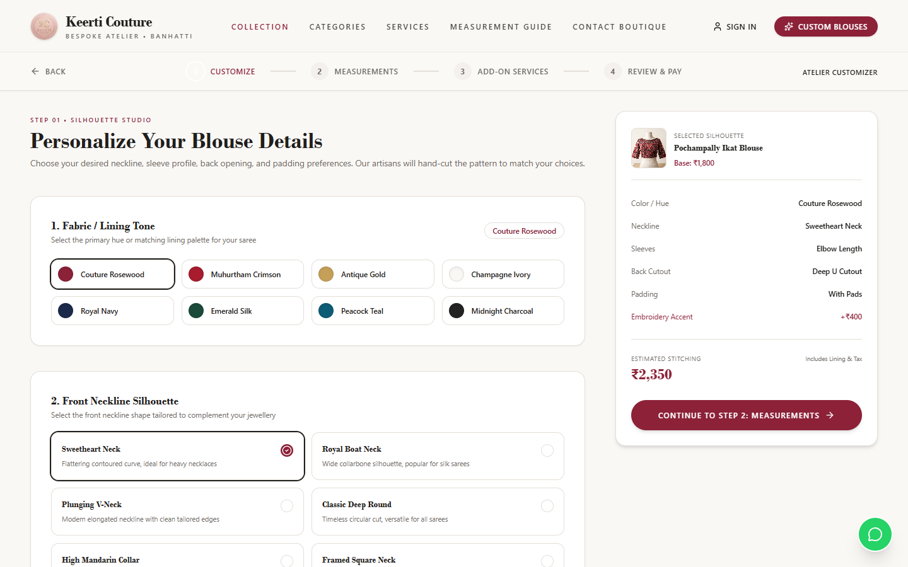
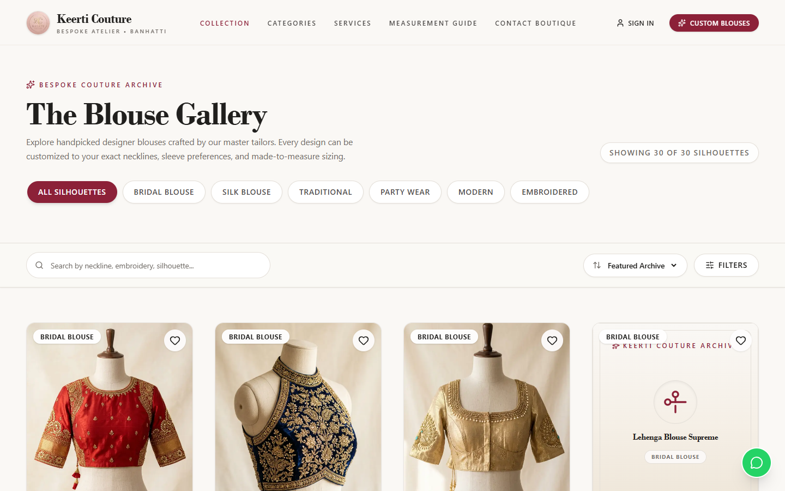
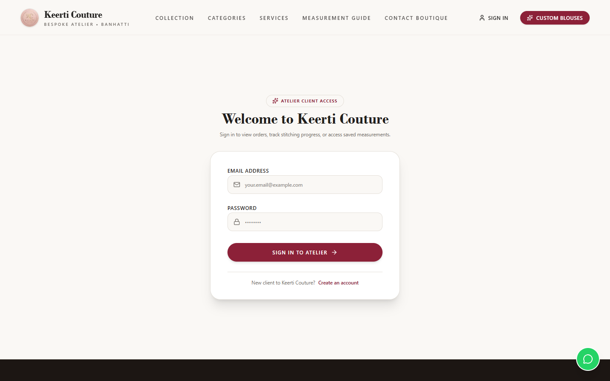
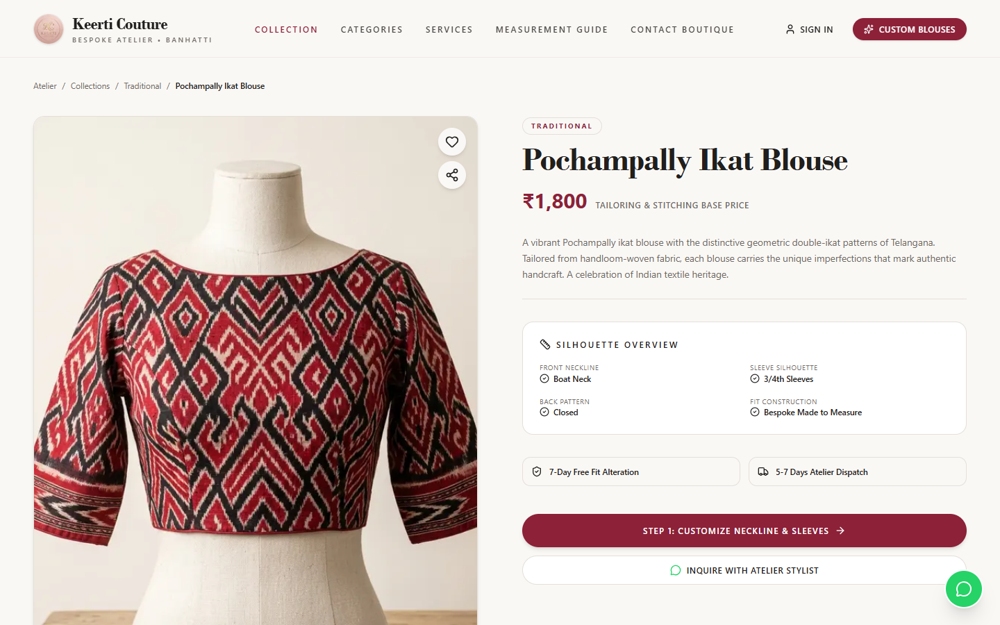
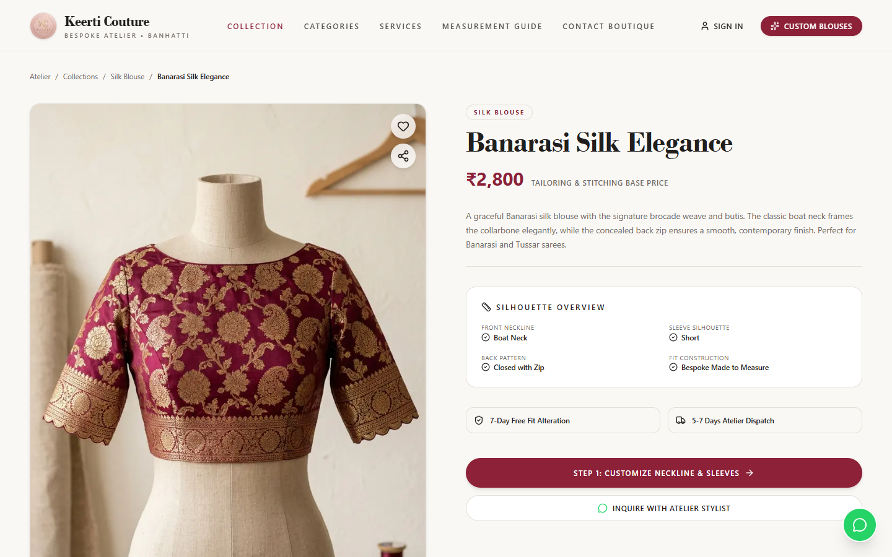
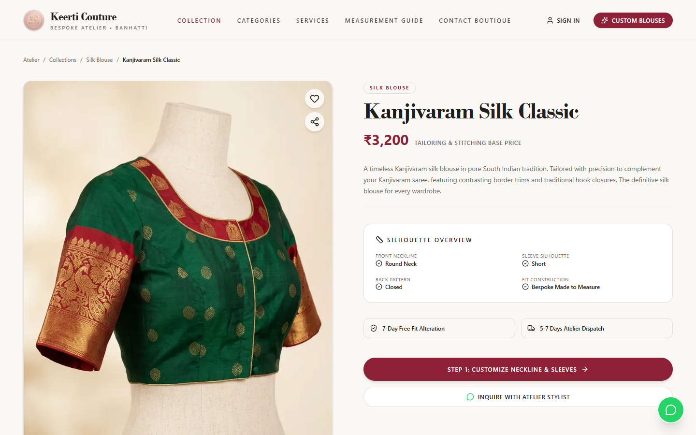

# Keerti Couture — Luxury Indian Blouse Atelier & Bespoke E-Commerce Platform

[]()
[](docs/TESTING.md)
[]()
[]()
[]()

> **Keerti Couture** is an haute couture digital atelier tailored for high-end Indian blouse design, bespoke customization, bridal tailoring, and luxury e-commerce. Built from the ground up to embody royal heritage aesthetics with high-performance modern web architecture.

---

## 🌟 Visual Showcase

| Haute Couture Homepage | Bespoke Blouse Customizer |
|:---:|:---:|
|  |  |

| Curated Blouse Catalogue | Atelier Admin Studio |
|:---:|:---:|
|  |  |

| Flagship: Pochampally Ikat | Flagship: Banarasi Silk | Flagship: Kanjivaram Silk |
|:---:|:---:|:---:|
|  |  |  |

*Full mobile and desktop visual evidence across 8 audited viewports is available in the [`docs/evidence/`](docs/evidence/) directory.*

---

## ✨ Key Features & Capabilities

- **Bespoke Blouse Customizer**: Interactive 3D/canvas-style neckline, sleeve, back cut, tassels, and embroidery selector with real-time price estimation.
- **Curated Haute Catalogue**: 30 distinct handcrafted blouse creations across 6 collections (*Bridal, Traditional, Silk, Party Wear, Modern Contemporary, Hand Embroidered*).
- **Flagship Detail Pages**: Rich product pages with high-resolution imagery, fabric details, artisan notes, and provenance badges.
- **Fitting Appointments**: Interactive scheduler with real-time double-booking prevention, automated calendar slots, and timezone preservation.
- **Custom Bridal Quotations**: Dedicated request portal allowing clients to submit inspiration images, fabric preferences, and custom embroidery briefs.
- **Saved Measurement Profiles**: Standardized 12-point blouse measurement forms with client-side validation and secure storage.
- **Order Lifecycle & Tracking**: Real-time status updates from *Order Placed* to *Pattern Cutting*, *Embroidery*, *Hand Stitching*, *Quality Check*, and *Dispatch*.
- **Atelier Admin Studio**: Comprehensive administrative dashboard for managing orders, designs, appointments, and quotation approvals.
- **Resilient Transactional Outbox**: Background worker with atomic database leasing ensuring 100% email delivery without HTTP blocking.
- **Responsive Across 8 Viewports**: 0px horizontal overflow across all devices (360px mobile through 1650px high-resolution displays).

---

## 🛠️ Technology Stack

| Layer | Technologies |
|---|---|
| **Frontend** | Next.js 16 (App Router), React 19, TypeScript, Tailwind CSS, Lucide React, Framer Motion |
| **Backend** | Node.js 20+, Express 4.21 (ES Modules), Mongoose 8.9 ODM |
| **Database** | MongoDB 8.0 Primary Store with Compound Indexing & Atomic Leasing |
| **Asset Pipeline** | Cloudinary API, Sharp Image Processing, Signed Upload Authorizations |
| **Communications** | Nodemailer, Transactional Outbox Pattern, Dual HTML/Text Luxury Templates |
| **Payments** | Razorpay Node.js SDK (Test Mode / Production Ready) |
| **Security** | Helmet, express-mongo-sanitize, CSRF Double-Submit Tokens, HttpOnly JWT Cookies, Rate Limiting |
| **DevOps & Infra** | Docker, Docker Compose, Nginx Reverse Proxy, Health & Readiness Probes |

---

## 🏛️ System Architecture

Keerti Couture utilizes a decoupled full-stack architecture with an ingress reverse proxy, stateless REST API, resilient outbox messaging worker, and persistent MongoDB cluster.

```
+-------------------------------------------------------------------------+
|                              CLIENT TIER                                |
|           Next.js 16 (React 19) • Tailwind CSS • Responsive UI          |
+------------------------------------+------------------------------------+
                                     | (HTTPS / REST)
+------------------------------------v------------------------------------+
|                         NGINX REVERSE PROXY                             |
|          SSL Termination • Gzip Compression • Rate Limiting Ingress     |
+------------------+----------------------------------+-------------------+
                   | (/api/*)                         | (/*)
+------------------v-------------------+   +----------v-------------------+
|            EXPRESS API               |   |     NEXT.JS SSR SERVER       |
|    JWT Auth • CSRF Defense • Helmet  |   |    Static & Dynamic Pages    |
+------------------+-------------------+   +------------------------------+
                   |
     +-------------+-------------+-----------------------+
     |                           |                       |
+----v---------------+   +-------v-------+       +-------v--------+
|   MONGODB 8.0      |   |  CLOUDINARY   |       |   NODEMAILER   |
| Primary Database   |   | Image Storage |       | Outbox Worker  |
+--------------------+   +---------------+       +----------------+
```

For complete diagrams and architectural deep-dives, see [`docs/ARCHITECTURE.md`](docs/ARCHITECTURE.md).

---

## 🚀 Quick Start (Local Development)

### Prerequisites
- Node.js >= 20.0.0
- MongoDB instance running on `localhost:27017`
- Git

### 1. Clone & Install
```bash
git clone https://github.com/kartikkontikall0-max/keerti-couture-atelier.git
cd keerti-couture-atelier

# Install backend dependencies
cd backend && npm install

# Install frontend dependencies
cd ../frontend && npm install
cd ..
```

### 2. Configure Environment Files
```bash
cp backend/.env.example backend/.env
cp frontend/.env.example frontend/.env.local
```
*(Review [`docs/ENVIRONMENT.md`](docs/ENVIRONMENT.md) for full variable details).*

### 3. Seed Realistic Atelier Catalogue & Accounts
```bash
cd backend
node seedDemo.js
```
*This populates 30 complete blouse designs, demo categories, customer profiles, and atelier staff accounts.*

### 4. Run Development Servers
```bash
# Terminal 1: Backend API
cd backend
npm run dev

# Terminal 2: Frontend Client
cd frontend
npm run dev
```

Visit `http://localhost:3000` to browse the atelier.

---

## 🐳 Docker Compose Deployment

To run the complete platform inside isolated containers:

```bash
docker compose up -d --build
```
- Frontend available at: `http://localhost:3000`
- Backend API available at: `http://localhost:5000`
- API Health Probe: `http://localhost:5000/health`
- API Readiness Probe: `http://localhost:5000/ready`

See [`docs/DEPLOYMENT.md`](docs/DEPLOYMENT.md) for Nginx, SSL, and cloud PaaS instructions.

---

## 🧪 Comprehensive Automated Testing (301 Tests)

Keerti Couture includes an extensive suite of automated integration, security, and concurrency tests.

```bash
cd backend
npm run test:all
```

```
============================================================
  KEERTI COUTURE — COMPLETE TEST RUNNER EXECUTION SUMMARY   
============================================================
  ✓ Phase 2 Security & CSRF Suite:        44 / 44 PASSED
  ✓ Phase 4 Workflows & State Suite:      83 / 83 PASSED
  ✓ Phase 5 Concurrency & Race Suite:     34 / 34 PASSED
  ✓ Staging Readiness Suite:              73 / 73 PASSED
  ✓ SEC-01 Input Validation Suite:        25 / 25 PASSED
  ✓ Cloudinary Image Pipeline Suite:      15 / 15 PASSED
  ✓ SMTP & Outbox Infrastructure Suite:   27 / 27 PASSED
------------------------------------------------------------
  TOTAL ASSERTIONS: 301 / 301 PASSED (100% SUCCESS)
============================================================
```

See [`docs/TESTING.md`](docs/TESTING.md) for test breakdowns.

---

## 🔒 Security Posture & SEC-01 Remediation

Keerti Couture implements defense-in-depth principles:
- **SEC-01 Type-Strict Input Defense**: Explicit non-string rejection prevents NoSQL operator injection across all authentication endpoints (`$gt`, `$ne`).
- **Strict Cookie Sessions**: HttpOnly, SameSite, and cryptographically signed JWT cookies.
- **CSRF Protection**: Double Submit Cookie validation on all mutating REST endpoints.
- **0 Known Vulnerabilities**: Zero high or critical vulnerabilities identified in `npm audit`.

Review the full security specification in [`docs/SECURITY.md`](docs/SECURITY.md).

---

## 🔑 Demo & Evaluation Accounts

The demo database includes pre-configured accounts for testing:

| Role | Email Address | Password | Permissions |
|---|---|---|---|
| **Atelier Admin** | `admin@keerticouture.com` | `KeertiAdmin@2025!` | Full dashboard, orders, designs, appointments |
| **Boutique Client** | `ananya.sharma@example.com` | `Customer@2025!` | Order tracking, saved measurements, appointments |

---

## 📚 Complete Documentation Index

- [System Architecture](docs/ARCHITECTURE.md) — Architectural diagrams, data flows, and design patterns.
- [Deployment Guide](docs/DEPLOYMENT.md) — Production Docker, Nginx SSL, and cloud hosting setup.
- [Security Specification](docs/SECURITY.md) — Threat models, SEC-01 remediation details, and compliance.
- [Testing & Quality Assurance](docs/TESTING.md) — 301-test audit report and execution commands.
- [Environment Configuration](docs/ENVIRONMENT.md) — Comprehensive reference for all configuration keys.
- [Release Notes](docs/RELEASE_NOTES.md) — Version 1.0.0-PROD changelog and milestone details.

---

## 📄 License & Attribution

Developed with passion by **Kartik Kontikal** ([@kartikkontikall0-max](https://github.com/kartikkontikall0-max)).  
Licensed under the [MIT License](LICENSE).
