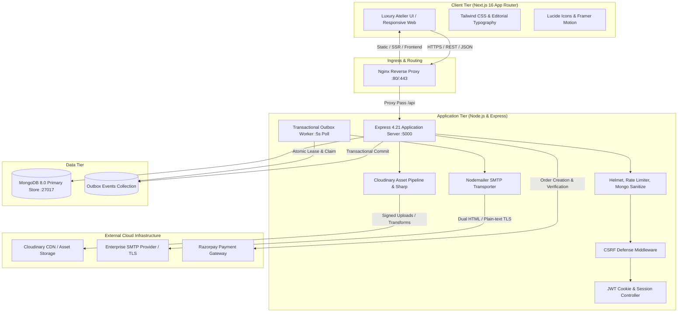
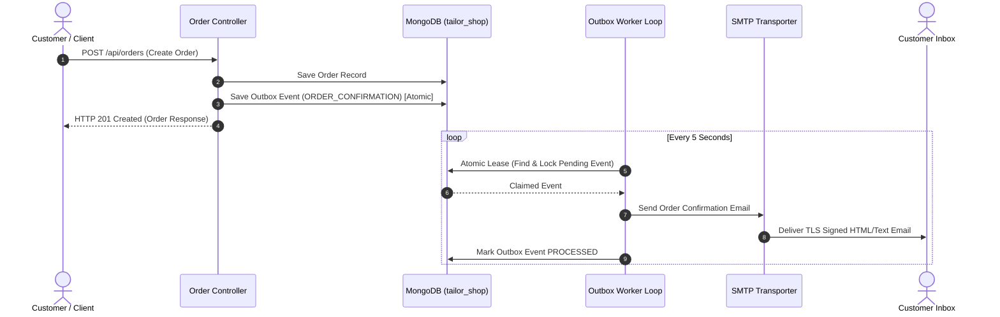

# Keerti Couture — System Architecture

Keerti Couture is an haute couture digital atelier tailored for high-end Indian blouse design, bespoke customization, bridal tailoring, and luxury e-commerce. Built from the ground up to embody royal heritage aesthetics with high-performance modern web architecture.

---

## 1. High-Level Architecture Diagram

---

## 2. Core Architectural Pillars

### A. Modular Full-Stack Decoupling
- **Frontend**: Next.js 16 (App Router), React 19, TypeScript, Tailwind CSS, Lucide React, and Framer Motion. All pages are statically optimized or server-rendered with zero horizontal overflow across 8 responsive breakpoints (360px to 1650px).
- **Backend**: Express 4.21 running on Node.js 20+ with ES Modules. Adheres strictly to the Controller-Service-Repository pattern with explicit route isolation.
- **Database**: MongoDB with Mongoose 8.9 ODM. Enforces strict schema validations, unique compound indexing, and atomic concurrency locking.

### B. Transactional Outbox Pattern for Resilient Messaging
Direct asynchronous side-effects (such as email dispatch) during HTTP requests are anti-patterns in mission-critical e-commerce. Keerti Couture guarantees delivery via an **Atomic Outbox Pattern**:
1. When an order is placed, an appointment is scheduled, or a user registers, the database transaction writes an `Outbox` document atomically within the same database write.
2. A background worker periodically claims pending events using atomic database leasing (`findOneAndUpdate` with timestamp locks and instance fencing).
3. Transports dispatch emails using dual HTML and plain-text templates with strict XSS sanitization.
4. Exponential backoff and maximum retry thresholds prevent thundering herds, routing exhausted messages into a Dead-Letter Queue (DLQ).

### C. Cloudinary Asset Management Pipeline
Product visuals, fabric textures, and embroidery patterns require high fidelity and rapid delivery:
- **Signed Upload Authorization**: Clients request signed parameters from `GET /api/upload/signature` without exposing API secrets.
- **Pre-Upload Validation**: Strict file type inspection (magic byte verification) and payload size clamping.
- **Format & Quality Optimization**: Sharp and Cloudinary transformations dynamically generate web-optimized WebP/AVIF formats and responsive image variants (`thumbnailUrl`, `cardUrl`, `optimizedUrl`).
- **Safe Replacement Protocol**: Old assets are retained until replacement uploads succeed, preventing broken images.
- **Graceful Fallback**: If Cloudinary credentials are unset in local or offline environments, the system returns clean HTTP 503 responses without crashing or polluting logs.

---

## 3. Data Model Overview

| Collection | Description | Primary Indexes |
|---|---|---|
| `users` | Customers, Atelier Staff, and Administrators | `email` (unique, lowercase), `role` |
| `products` | Luxury blouse designs, collections, and pricing | `category`, `isActive`, `slug` |
| `orders` | Placed orders, tailoring specifications, and invoices | `user`, `orderNumber` (unique), `status` |
| `appointments` | In-person and virtual bridal fitting consultations | `user`, `date`, `slot`, `status` |
| `quotations` | Custom bridal and bespoke embroidery quotes | `user`, `status`, `createdAt` |
| `measurements` | Saved customer blouse measurement profiles | `user`, `profileName` |
| `outbox` | Resilient transactional messaging events | `status`, `nextRetryAt`, `leasedUntil` |

---

## 4. Security & Compliance Architecture
1. **SEC-01 Type-Strict Input Defense**: Explicit non-string rejection prevents NoSQL operator injection across all authentication endpoints (`$gt`, `$ne`).
2. **Strict Cookie Session Security**: `httpOnly`, `sameSite: lax`/`strict`, `secure` (in production).
3. **Double Submit CSRF Protection**: Cryptographic tokens for mutation endpoints (`POST`, `PUT`, `DELETE`).
4. **Defense in Depth**: Helmet headers, express-mongo-sanitize, strict CORS origin white-listing, and tiered IP rate limiting.

